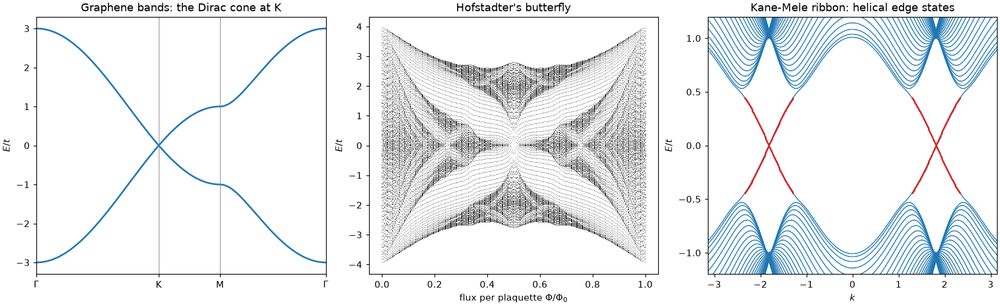
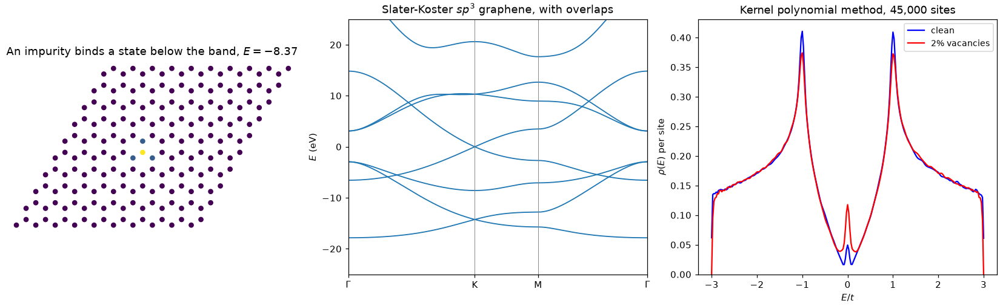
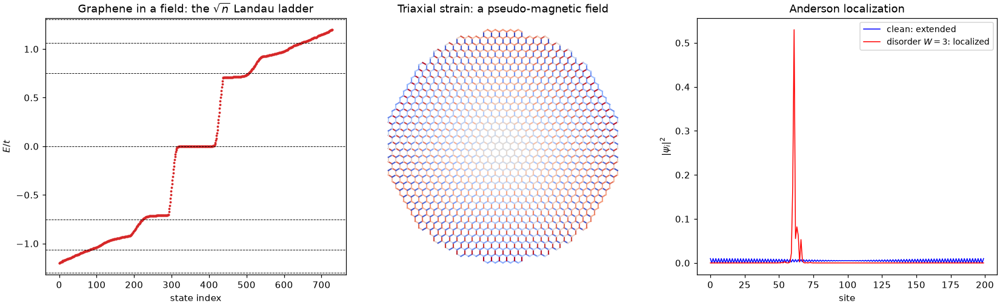
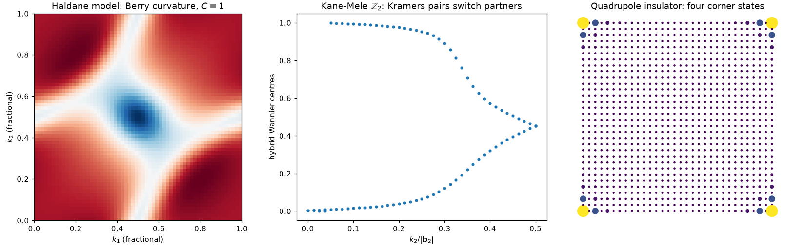
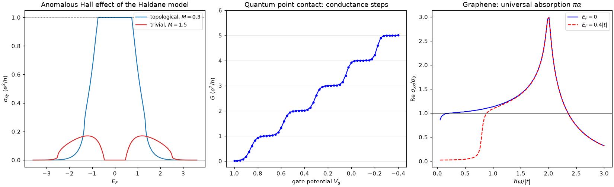
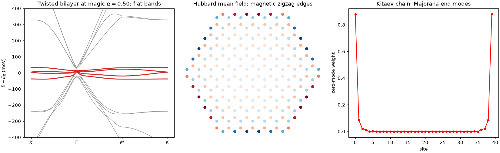
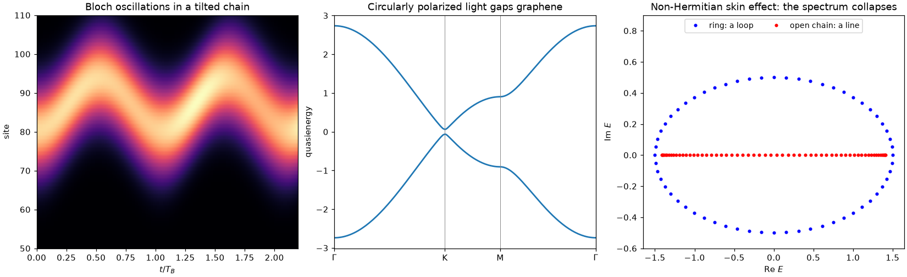

.. tbkit documentation master file, created by
   sphinx-quickstart on Sat Feb 13 09:54:24 2016.
   You can adapt this file completely to your liking, but it should at least
   contain the root `toctree` directive.

.. Google Search Console ownership check (same token as cpoli.github.io).
.. meta::
   :google-site-verification: -kU_m9kdHUpm0800RreI0ftx_vcH5XIWWkT0mzcWWTE

tbkit
=====

.. toctree::
    :hidden:

    tutorial
    history/index
    api/gallery/index
    tbkit

**tbkit** is a Python package to build and solve **Tight-Binding** models,
written in fully vectorized **NumPy**. It's built for physics students
working through a textbook problem, curious learners exploring a topic
on their own, and educators building a demonstration.

Start with the :doc:`tutorial`, trace the :doc:`history of Tight-Binding
breakthroughs </history/index>`, browse the :doc:`example gallery
</api/gallery/index>`, or jump straight to the :doc:`API reference <tbkit>`.

For computational physics beyond tight-binding -- quantum mechanics,
classical mechanics, statistical physics, general relativity, and more
-- see `physicskit <https://cpoli.github.io/physicskit/>`_, whose
``physicskit.condensed`` subpackage covers tight-binding band theory and
topology alongside superconductivity.

Examples
--------

Building and solving models
~~~~~~~~~~~~~~~~~~~~~~~~~~~

Finite lattices, defects, several orbitals per site, real space to k-space
and back, k·p models discretized into lattice models, saved models and
Wannier90 imports, maximally localized Wannier functions, and solvers for
very large lattices.

Fields, strain and disorder
~~~~~~~~~~~~~~~~~~~~~~~~~~~

What happens to a lattice under a magnetic field (Peierls substitution),
under strain, and with disorder.

Band topology
~~~~~~~~~~~~~

Chern numbers, Berry phases, the Z2 invariant (and the four 3D indices),
spin and mirror Chern numbers, the Bott index and entanglement spectrum,
Weyl points and their chirality, Kitaev's Majorana number, quantum geometry,
symmetry classes, higher-order and 3D topological phases.

Response and transport
~~~~~~~~~~~~~~~~~~~~~~

Hall conductivities at any Fermi level (with the orbital magnetization,
Nernst and thermal Hall responses), Landauer transport between leads, and
linear and nonlinear optical response.

Flat bands and interactions
~~~~~~~~~~~~~~~~~~~~~~~~~~~

Flat bands from lattice geometry and from a moiré twist, the Hubbard model
in mean field, and superconductivity.

Driven and open systems
~~~~~~~~~~~~~~~~~~~~~~~

Wavepacket dynamics, periodically driven (Floquet) lattices, and
non-Hermitian bands with exceptional points.

Install
-------

To use **tbkit**:

  * Install Python 3.10 or later and three additional packages:

      * numpy
      * scipy
      * matplotlib

  * ``pip install tbkit`` or ``conda install -c conda-forge tbkit``, or
    ``pip install -e .`` from a clone of the repository.

Examples are available at https://github.com/cpoli/tbkit/tree/master/examples,
and rendered with their output in the :doc:`example gallery
</api/gallery/index>`.